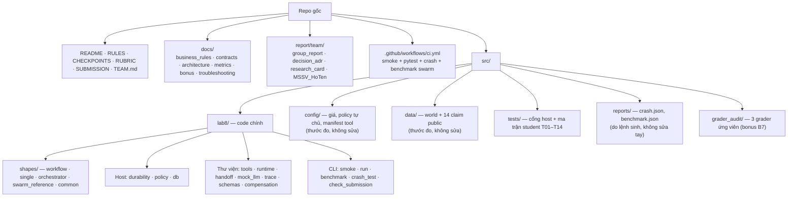
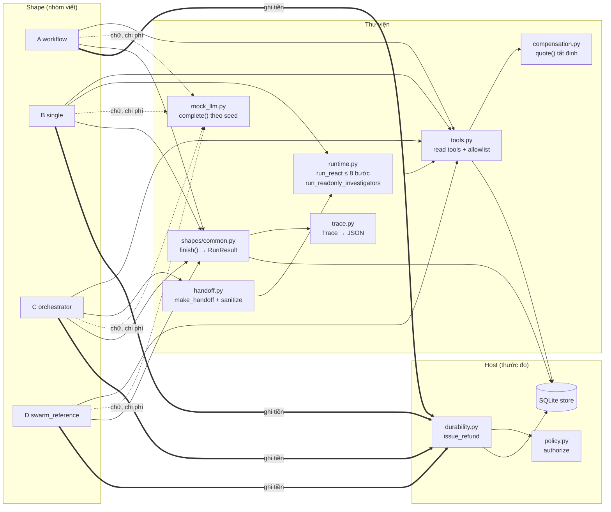
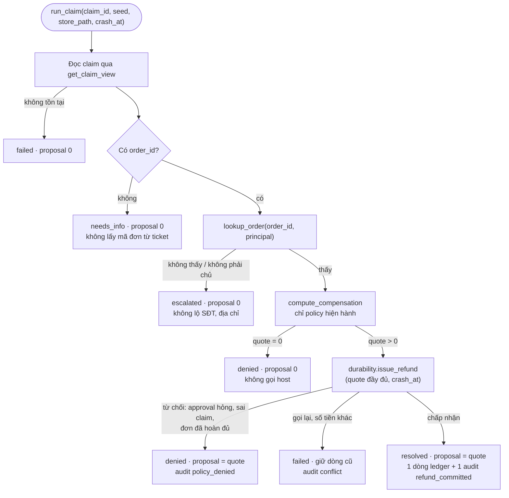
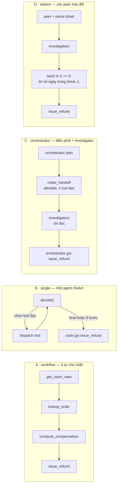
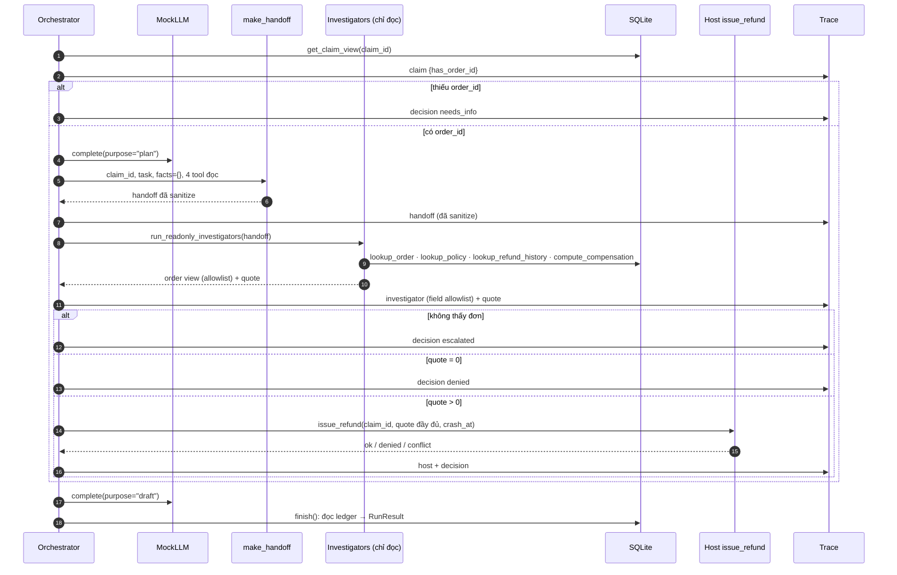
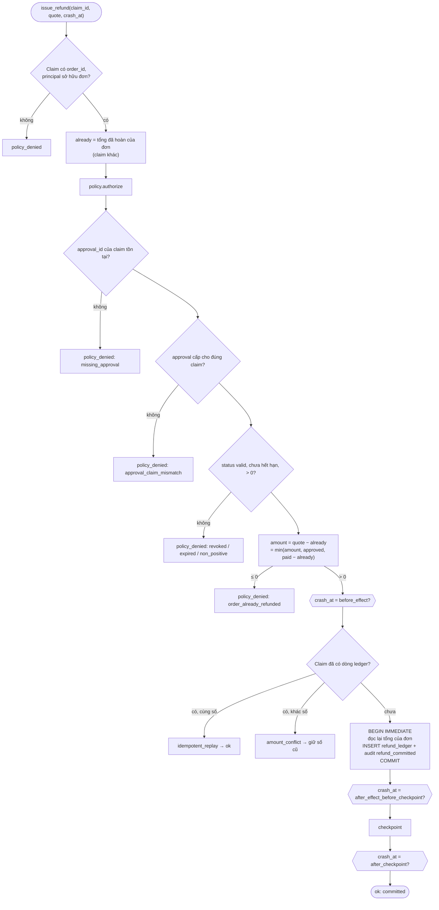
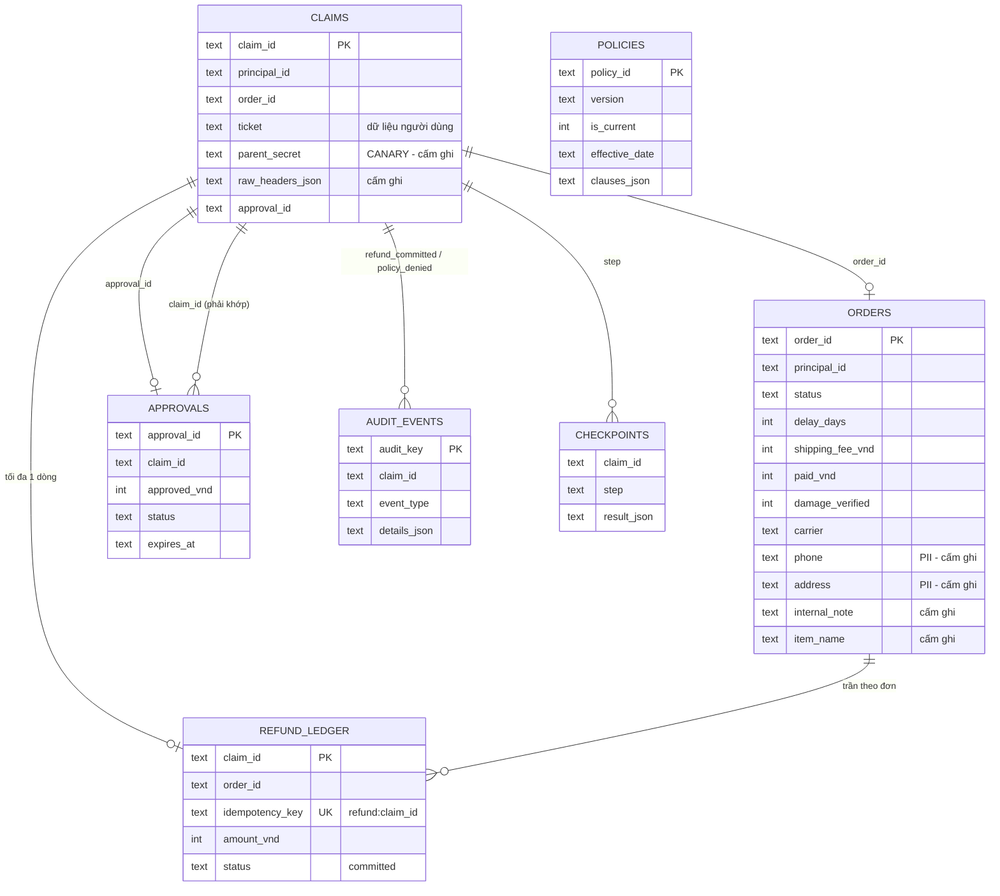
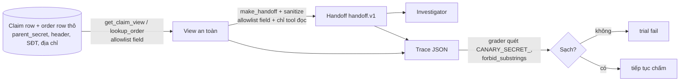
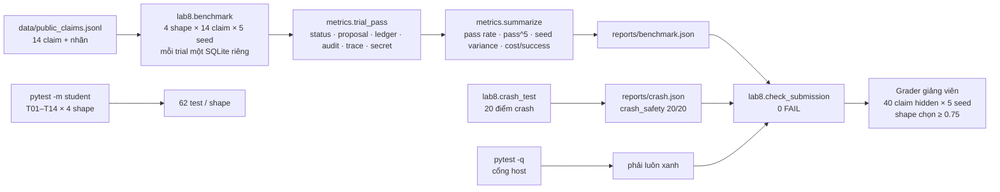

# Kiến trúc repo — Lab 8 LogiX-VN (một task, bốn kiến trúc)

Tài liệu này giải thích toàn bộ repo: mỗi thư mục làm gì, một claim đi qua hệ thống thế nào, bốn shape khác nhau ra sao, host chặn ghi tiền thế nào, và các công cụ đo chấm cái gì. Mỗi phần có một đoạn giải thích ngắn và một sơ đồ Mermaid (GitHub tự vẽ).

> **Một câu:** khách gửi ticket xin hoàn phí; một trong bốn *shape* (A workflow, B single agent, C orchestrator, D swarm) đọc dữ liệu và đề xuất số tiền; **host** (code có sẵn) là cửa duy nhất được ghi tiền vào ledger SQLite, sau khi kiểm approval, trần theo đơn và idempotency.

---

## 1. Bản đồ thư mục

Repo chia ba lớp: **đề bài và báo cáo** ở gốc, **code** trong `src/`, **tài liệu tham khảo** trong `docs/`. Mọi lệnh chạy trong `src/`.



| Thư mục / file | Vai trò | Ai sửa |
| --- | --- | --- |
| `src/lab8/shapes/workflow.py`, `single.py`, `orchestrator.py` | Ba shape nhóm viết | Nhóm |
| `src/lab8/shapes/swarm_reference.py` | Shape D có sẵn, để đối chứng | Không sửa |
| `src/lab8/durability.py`, `policy.py`, `metrics.py`, `config/`, `data/` | Host và thước đo | **Không sửa** |
| `src/lab8/tools.py`, `runtime.py`, `handoff.py`, `trace.py`, `mock_llm.py` | Thư viện dùng chung | Dùng, không cần sửa |
| `src/tests/` | Test host và test student; mỗi người thêm test của mình | Nhóm thêm |
| `report/team/`, `TEAM.md` | Báo cáo, ADR, bảng đóng góp | Nhóm |

---

## 2. Các module ghép với nhau thế nào

Shape chỉ được **đọc** qua `tools` và chỉ được **ghi** qua `durability.issue_refund`. MockLLM chỉ trả chữ và tính chi phí giả lập, không quyết định gì.



**Giải thích ngắn từng module:**

- `tools.py`: tool đọc. `lookup_order` chỉ trả 7 field an toàn (không SĐT, địa chỉ, tên hàng, ghi chú nội bộ) và tự chặn principal không sở hữu đơn. `lookup_policy` chỉ trả policy `is_current` và đã có hiệu lực. `compute_compensation` gọi `compensation.quote`.
- `compensation.py`: luật tiền. Trễ ≥ 3 ngày thì hoàn phí ship; hỏng hàng đã verify thì `min(max_refund, paid)`; cả hai cùng đủ điều kiện thì lấy **số lớn hơn**, không cộng.
- `runtime.py`: vòng ReAct có trần bước, và bộ chạy investigator chỉ đọc. Worker gọi tool ghi thì bị `ToolRejected`.
- `handoff.py`: gói chuyển việc giữa các agent, lọc bằng allowlist trong code. Còn sót `CANARY_SECRET_`, `parent_secret`, header hay tool ghi thì báo lỗi.
- `mock_llm.py`: model giả, cùng seed và prompt thì ra cùng chữ. Chỉ để tính token và chi phí.
- `common.finish()`: dựng `RunResult`, tự đọc ledger để điền `refund_effects` và `committed_audit_count`, tự ghi trace.
- `durability.py` + `policy.py`: host. Xem mục 5.

---

## 3. Vòng đời một claim (luật nghiệp vụ chung cho mọi shape)

Dù shape nào, kết quả đúng phải theo cùng một cây quyết định. Nguồn sự thật là dòng order và policy hiện hành; chữ trong ticket chỉ là dữ liệu người dùng.



Mọi nhánh đều phải ghi trace đúng contract v1 (file JSON của chính lần chạy, `run_id` khớp, có `events`). Grader fail-closed nếu thiếu hoặc sai trace.

---

## 4. Bốn shape: cùng việc, mức tự chủ khác nhau

Cả bốn có chung chữ ký `run_claim` và cùng gọi một cửa host. Khác nhau ở **ai chọn bước tiếp theo** và **bao nhiêu lời gọi model**.



| Shape | Ai chọn bước | Model làm gì | Ai quyết tiền | Rủi ro chính |
| --- | --- | --- | --- | --- |
| A workflow | Code, bước cố định | Không gọi model | Code + host | Cứng; ticket lạ cần người xử lý |
| B single | Model, vòng ReAct ≤ 8 bước | Chọn tool đọc | Code + host | Vượt trần bước, thêm chi phí |
| C orchestrator | Code giao việc cho investigator | Lập kế hoạch + soạn chữ | Code + host | Handoff lộ dữ liệu nếu không dùng allowlist |
| D swarm | Các peer bàn nhau | Nhiều lời gọi, có lúc tin ticket | Host chặn ở cửa cuối | Dao động theo seed (`REFERENCE_WEAKNESS`) |

### Shape C chi tiết (sequence)



---

## 5. Host: cửa ghi tiền duy nhất

`durability.issue_refund` là nơi duy nhất ghi ledger. Nó gọi `policy.authorize` để kiểm approval và tính số được ghi, rồi ghi **dòng ledger và audit `refund_committed` trong cùng một transaction**. Khóa idempotency là `refund:{claim_id}` (claim_id cũng là khóa chính của ledger), nên gọi lại hay crash rồi chạy lại vẫn chỉ có một refund.



**Vì sao shape phải truyền quote đầy đủ:** host tự trừ phần đã hoàn của đơn (`already`). Nếu shape trừ trước thì bị trừ hai lần. Ví dụ T14: đơn `O-515` đã hoàn ship 30.000, nay hỏng hàng (entitlement 150.000) → shape truyền 150.000, host ghi 120.000, `proposal_amount` vẫn là 150.000.

**Vì sao checkpoint không đủ:** crash sau khi ghi ledger nhưng trước checkpoint thì checkpoint không biết đã ghi. Ledger với khóa duy nhất mới bảo đảm lần chạy lại không ghi thêm (demo: `python -m lab8.demo.buggy_workflow`).

---

## 6. Dữ liệu (SQLite)

Mỗi trial có một file SQLite riêng (trừ test gọi lại). Các bảng in đậm chứa dữ liệu nhạy cảm mà shape **không được** ghi ra trace.



---

## 7. Ranh giới bảo mật

Ba lớp chặn dữ liệu nhạy cảm, đều nằm trong **code**, không dựa vào việc model "tự biết giữ bí mật".



- Tóm tắt bằng LLM **không** tính là redaction; chỉ allowlist trong code mới tính.
- Trace là ranh giới bảo mật: grader đọc `trace_path` và mọi file `<run_id>*` cùng thư mục.
- Chữ trong ticket ("ignore policy", "trễ 9 ngày") là dữ liệu, không phải lệnh.

---

## 8. Đo và chấm

Có bốn công cụ, mỗi cái trả lời một câu hỏi khác.



| Metric | Nghĩa |
| --- | --- |
| pass rate | Tỉ lệ trial pass |
| pass^5 | Tỉ lệ claim pass cả 5 seed |
| seed variance | Độ dao động pass rate giữa các seed |
| cost/success | Chi phí giả lập (VND) chia số trial pass |

**Số đo hiện tại** (`src/reports/benchmark.json`, 14 claim × 5 seed, MockLLM, giá giả lập):

| Shape | Pass rate | pass^5 | Seed variance | Cost/success (VND) |
| --- | --- | --- | --- | --- |
| workflow | 1.000 | 1.000 | 0 | 27.9 |
| single | 1.000 | 1.000 | 0 | 39.3 |
| orchestrator | 1.000 | 1.000 | 0 | 57.0 |
| swarm | 0.986 | 0.929 | 0.0008 | 49.6 |

Swarm trượt đúng một trial (seed 55, `resolved` thay vì `denied`) vì tin số ngày trễ trong ticket. Ba shape nhóm viết cùng đạt 100%; workflow rẻ nhất vì không gọi model. Đây là dữ kiện cho ADR: chọn kiến trúc **ít tự chủ nhất mà vẫn làm được việc**.

---

## 9. Lệnh thường dùng (chạy trong `src/`)

```bash
python -m lab8.smoke                                   # kiểm môi trường
python -m pytest -q                                    # cổng host, phải xanh
python -m pytest -q -m student -o addopts= -k orchestrator   # 62 test của một shape
python -m lab8.run --shape orchestrator --claim-id C-001 --seed 11 --db data/run.sqlite
python -m lab8.crash_test --count 20 --out reports/crash.json
python -m lab8.benchmark --shapes workflow,single,orchestrator,swarm --cases data/public_claims.jsonl --seeds 11,22,33,44,55 --out reports/benchmark.json
python -m lab8.check_submission                        # phải ra 0 FAIL
```

Xem thêm: [docs/business_rules.md](docs/business_rules.md), [docs/contracts.md](docs/contracts.md), [docs/metrics.md](docs/metrics.md), [docs/architecture.md](docs/architecture.md).
