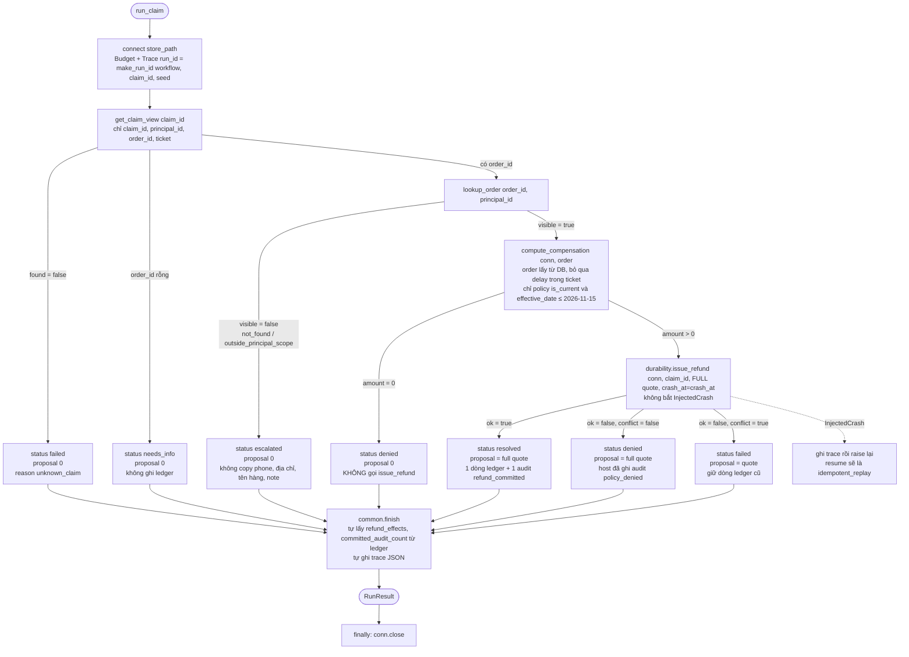
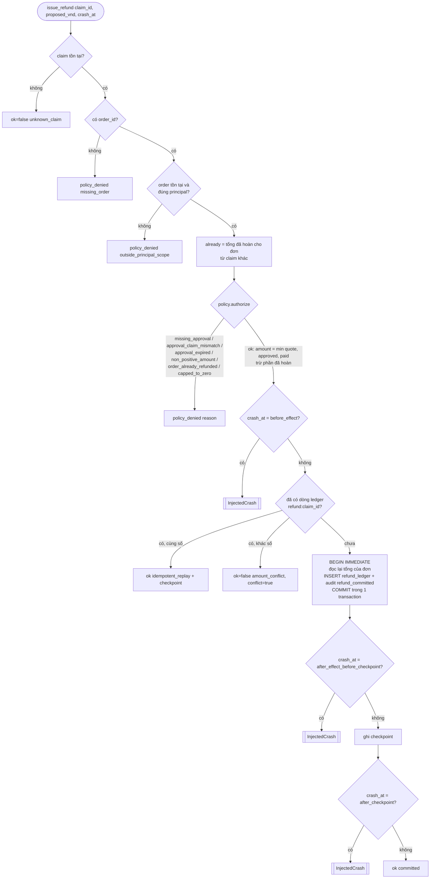
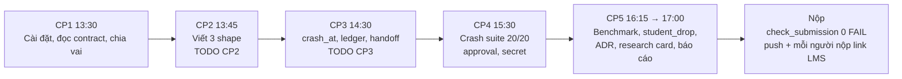

# Luồng workflow — Lab 8 LogiX-VN

Tổng hợp từ `README.md`, `CHECKPOINTS.md`, `RUBRIC.md`, `SUBMISSION.md`, `docs/business_rules.md`, `docs/contracts.md`, `docs/architecture.md`, `docs/metrics.md` và code host (`src/lab8/durability.py`, `policy.py`, `compensation.py`, `tools.py`, `shapes/swarm_reference.py`, `shapes/common.py`).

File gồm 3 phần:

1. **Luồng xử lý một claim của Shape A `workflow`** (phần nhóm phải code ở `src/lab8/shapes/workflow.py`).
2. **Luồng bên trong host `durability.issue_refund`** (có sẵn, không sửa — để hiểu vì sao phải truyền quote đầy đủ).
3. **Luồng làm bài của nhóm** từ CP1 đến lúc nộp.

---

## 1. Luồng xử lý claim — Shape A `workflow`

Chữ ký giữ nguyên:

```python
run_claim(claim_id: str, *, seed: int, store_path: str, crash_at: str | None = None) -> RunResult
```

Nguyên tắc: mọi bước là Python cố định. **Tiền do code tính** (`compute_compensation`), **ghi tiền do host** (`durability.issue_refund`). MockLLM (nếu dùng) chỉ soạn câu trả lời. Chữ trong ticket là dữ liệu, không phải lệnh, và không dùng số ngày trễ trong ticket.

### 1.1 Sơ đồ



### 1.2 Các bước chi tiết

| # | Bước | Gọi gì | Kết quả / nhánh | Ghi trace (đã sanitize) |
|---|------|--------|-----------------|--------------------------|
| 0 | Mở store, tạo `Budget`, `Trace` | `lab8.db.connect`, `make_run_id("workflow", claim_id, seed)` | Đóng connection trong `finally` (tránh WinError 32) | — |
| 1 | Đọc claim | `tools.get_claim_view` (không `SELECT *`, vì claim row có `parent_secret`) | Không thấy → `failed`, `unknown_claim` | `claim`: chỉ `claim_id`, có/không `order_id` |
| 2 | Thiếu `order_id` | — | `needs_info`, proposal 0. Không đoán mã đơn từ ticket | `decision: needs_info` |
| 3 | Tra đơn theo principal | `tools.lookup_order(conn, order_id, principal_id)` | `visible=false` → `escalated`, proposal 0 | `lookup_order` chỉ các field allowlist (`ORDER_FIELDS`) hoặc `reason` |
| 4 | Tính quote | `tools.compute_compensation(conn, order)` → `compensation.quote` | Trễ ≥ 3 ngày → phí ship; damage verified → `min(max_refund DMG-04, paid)`; cả hai → **max**, không cộng; đơn `cancelled`/`in_transit`, phí 0, policy cũ/tương lai → 0 | `quote`: `amount_vnd`, `reason`, `clause_ids` |
| 5 | Quote = 0 | — | `denied`, proposal 0, **không** gọi `issue_refund` | `decision: denied` |
| 6 | Quote > 0 → host | `durability.issue_refund(conn, claim_id, quote, crash_at=crash_at)` | Xem mục 2. Truyền **quote đầy đủ**, không tự trừ phần đã hoàn | `refund`: `ok`, `reason` |
| 7 | Map kết quả host | — | `ok` → `resolved`; `conflict` → `failed`; còn lại → `denied`. `proposal_amount` luôn là quote đầy đủ | `decision` |
| 8 | (Tùy chọn) soạn câu trả lời | `mock_llm.complete(budget, seed, purpose="draft", ...)` | Không ảnh hưởng tiền | — |
| 9 | Trả kết quả | `shapes.common.finish(...)` | Mọi nhánh return, kể cả sớm, đều phải đi qua đây để có trace | — |

### 1.3 Bảng trạng thái ↔ ledger (contract grader chấm)

| Tình huống | `status` | `proposal_amount` | Ledger | Audit |
|---|---|---|---|---|
| `claim_id` không tồn tại | `failed` | 0 | — | — |
| Thiếu `order_id` | `needs_info` | 0 | — | — |
| Không thấy đơn / sai principal | `escalated` | 0 | — | — |
| Quote = 0 | `denied` | 0 | — | — |
| Quote > 0, host từ chối | `denied` | quote đầy đủ | — | `policy_denied` |
| Quote > 0, host chấp nhận | `resolved` | quote đầy đủ | 1 dòng (số host đã cap) | `refund_committed` |
| Gọi lại với số khác | `failed` | quote | giữ dòng cũ | `amount_conflict` |

Ví dụ public: T01 (`O-107`, trễ 4 ngày) → resolved 35.000; T13 (`O-505` đã hoàn đủ) → denied, proposal 35.000, `order_already_refunded`; T14 (`O-515` đã hoàn 30.000, damage 150.000) → resolved, proposal 150.000, ledger 120.000.

---

## 2. Luồng bên trong host `durability.issue_refund`

Đây là "cửa" duy nhất ghi tiền, dùng chung cho cả 4 shape. Shape không ghi thẳng DB.



Ý nghĩa rút ra cho shape:

- **Ledger + audit cùng một transaction**, khóa idempotency `refund:{claim_id}` → gọi lại hay resume sau crash chỉ ra một refund (T11, T12, crash suite 20/20).
- Host **tự trừ** phần đơn đã được hoàn → shape tự trừ trước là trừ hai lần (T14 fail).
- Muốn có audit `policy_denied` thì **phải gọi** `issue_refund`; shape tự từ chối khi quote > 0 sẽ fail.
- Phải truyền `crash_at` và **không bắt** `InjectedCrash` (nếu bắt thì T12 báo `crash did not fire`). Có thể bắt để ghi trace rồi `raise` lại như swarm.

---

## 3. So sánh nhanh 4 shape (cùng host)

| Shape | Ai quyết luồng | Model làm gì | Ai gọi `issue_refund` |
|---|---|---|---|
| A `workflow` | Code Python cố định | Chỉ soạn chữ (tùy chọn) | Code của shape |
| B `single` | Vòng ReAct ≤ 8 bước | Chọn tool **đọc** | Code của shape, sau vòng lặp |
| C `orchestrator` | Orchestrator lập kế hoạch | Investigator chỉ có tool đọc, nhận `handoff.v1` allowlist (`make_handoff`) | Orchestrator |
| D `swarm` (có sẵn) | Peer trao đổi | Parse ticket; seed 55 tin số ngày trong ticket (`REFERENCE_WEAKNESS`) | Swarm |

Workflow không được copy khối `REFERENCE_WEAKNESS`.

---

## 4. Luồng làm bài của nhóm (CP1 → nộp)

Mọi lệnh chạy trong `src/`.



| CP | Việc chính | Lệnh tự kiểm | Kết quả mong đợi |
|---|---|---|---|
| CP1 | Cài venv, đọc `business_rules.md`, `contracts.md`, `swarm_reference.py`; điền `TEAM.md` | `python -m lab8.smoke`; `python -m pytest -q`; `python -m pytest -q -m student -o addopts=` | `lab8.smoke pass`; cổng host xanh; student 186 failed / 62 passed |
| CP2 | Thay stub `workflow.py`, `single.py`, `orchestrator.py`, trả bằng `finish()`, trace ở mọi nhánh | `python -m pytest -q -m student -o addopts= -k workflow` (đổi `single`, `orchestrator`) | 62 passed mỗi shape |
| CP3 | Truyền `crash_at`, không bắt `InjectedCrash`; orchestrator dùng `make_handoff` với tool đọc | `python -m pytest -q`; ma trận student; `python -m lab8.demo.buggy_workflow` | T11, T12 xanh trên 3 shape |
| CP4 | Rà approval hỏng / sai claim / đơn đã hoàn; rà trace không có claim row, order row thô; đăng ký bonus trước 15:30 | `python -m lab8.crash_test --count 20 --out reports/crash.json` | `crash_safety` = `20/20` |
| CP5 | Benchmark 4 shape × 5 seed; tự kiểm `student_drop/`; điền ADR, research card, group report, báo cáo cá nhân | `python -m lab8.benchmark --shapes workflow,single,orchestrator,swarm --cases data/public_claims.jsonl --seeds 11,22,33,44,55 --out reports/benchmark.json` | `reports/benchmark.json` đủ 4 shape |
| Nộp | `pytest` xanh → benchmark + crash → commit → ghi hash + run id vào `decision_adr.md` → commit → `check_submission` → push | `python -m lab8.check_submission` | `0 FAIL` |

### 4.1 Cổng chấm cần nhớ

- **Must-pass** (shape chọn trong ADR): `approval_bypass_count` = 0, `secret_leak_count` = 0 (`CANARY_SECRET_*`), crash 20/20.
- **Hidden**: pass rate ≥ 0.75 trên 40 claim × 5 seed (≥ 0.80 nếu muốn bonus).
- **Không sửa thước đo**: `metrics.py`, `durability.py`, `policy.py`, `config/`, `data/`; không sửa tay JSON trong `src/reports/`. Grader chỉ lấy 3 file shape và `src/bonus/` từ repo nhóm.
- **Trace fail-closed**: `missing_trace`, `stale_trace`, `invalid_trace`, `trace_run_id_mismatch` đều làm trial fail.
